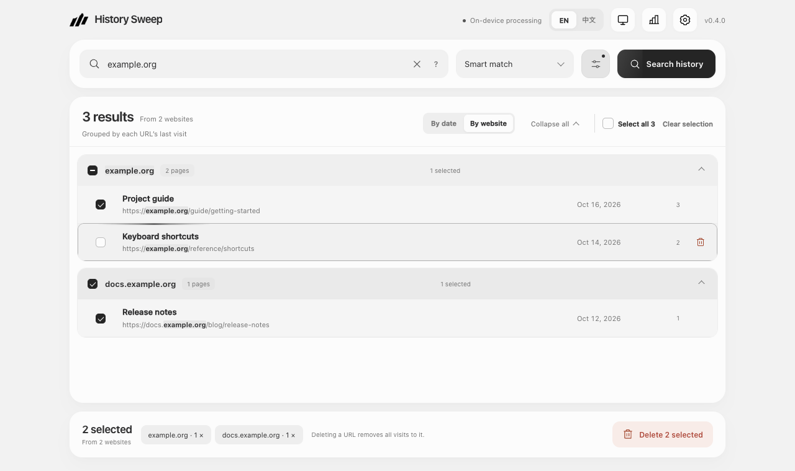
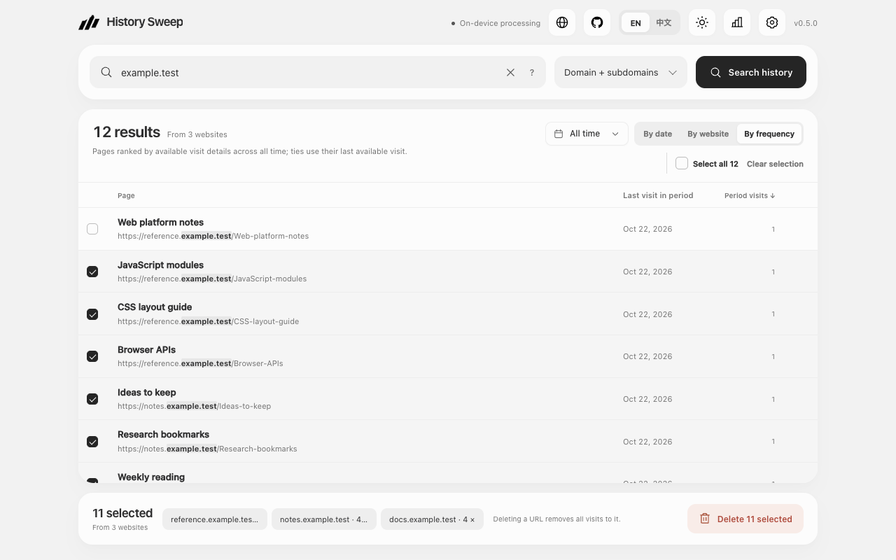

# History Sweep

**English** · [简体中文](README.zh-CN.md)

Find the browsing history you want to remove. Keep everything else.

History Sweep is a Chrome extension that helps you search, review, and delete browsing history by website, keyword, or date. Clear a single page or a batch of results without wiping your entire history. Everything is processed on your device, with no account or history upload.

[Install from Chrome Web Store](https://chromewebstore.google.com/detail/bbccfejdhhcjmpfagjckiikgllpojhgm) · [Website](https://sweep.agentclub.dev/)

## What you can do

- **Find the right pages.** Search by website, exact domain, domain and subdomains, or words in page titles and URLs. Suggestions from your own history help you complete a search, with support for Simplified and Traditional Chinese text.
- **Narrow down by date.** Choose today, the last 3, 7 or 30 days, or a custom date range. You can also search by date without a keyword.
- **Browse recent history by date or website.** Opening the extension shows the last three local calendar days. Expand a date to see website summaries, or switch to website grouping over the same results. Counts refer to unique pages, grouped by each URL’s last visit.
- **View local activity.** The chart icon beside Settings opens a yearly or three-month heatmap. Cleanup totals include verified tasks and confirmed removed URLs, starting when tracking begins. Daily counts and one website summary per date stay on this device: hostname, latest page title when available, and last-visit time. Full deleted URLs are not logged. Both views show website icons ordered by latest visit, wrapping onto additional rows; hover to preview a date and click to pin it. The browsing view groups existing pages by their last visit date, not daily visit counts.
- **Keep websites you care about.** Add domains to your kept websites. Their pages and subdomains stay out of deletion.
- **Delete one page or a batch.** Review the selected URLs before confirming. Deleting a single row leaves your other batch selections in place.
- **Choose your space.** Use a compact toolbar popup, a full-page workspace, or a modal over the current webpage. Change the opening method in Preferences.
- **Search the current website.** Use the popup's current-website button or the page's right-click menu to find that site's history.
- **Use English or Simplified Chinese.** Switch languages in the extension; your choice is remembered.

The overview above illustrates v0.4.0. The current Chrome Web Store release is **v0.5.0**, verified on October 25, 2026. Its additions are described below; later development work is marked separately.

## Current release — v0.5.0

v0.5.0 includes [frequency browsing and defaults #8](https://github.com/agent-club/history-sweep/issues/8), navigation and privacy improvements, and [configuration sync #14](https://github.com/agent-club/history-sweep/issues/14). Public availability is verified from the [Chrome Web Store listing](https://chromewebstore.google.com/detail/bbccfejdhhcjmpfagjckiikgllpojhgm). GitHub planning status is managed separately.

- **Browse by frequency.** Choose **By frequency** to rank pages by visits within the selected period. Ties use the last visit within that period. A page remains eligible if it was also visited later. Date and website views continue to filter by each URL’s last visit. Incomplete counts are reported as an error rather than shown as a partial ranking.
- **Set your browsing defaults.** First use opens **By website** for today and the previous six local calendar days. Save the default view and relative range in **Preferences → Default browsing settings**. Temporary filters leave those defaults unchanged; fixed custom dates cannot be saved as defaults. Keyword searches still use all time unless you explicitly choose a range.
- **Private cleanup.** Save **Preferences → Private cleanup** to stop new cleanups from saving counts or website details in Local activity. Existing activity stays on this device. The activity panel opens with Browsing history first; scrolling up can collapse it, and group headings stay visible as you browse.
- **Return and reopen quickly.** A lower-right **Back to top** button returns to the beginning of a long list and respects reduced motion. With no saved opening preference, the extension opens over the current webpage; existing opening choices are preserved. **Preferences → Change keyboard shortcut** shows Chrome’s current binding and opens its shortcut settings; Chrome must be focused.
- **Sync configuration and keep a recovery file.** Use **Preferences → Sync & disk backup** to manually transfer language, appearance and opening preferences to your own HTTPS WebDAV file. Export a password-encrypted disk backup outside the extension folder for recovery after uninstall. Host access is requested only when you initiate a connection test or transfer; browsing history is excluded. The provider can read the remote JSON.
- **Check for store updates.** The store installation checks public version metadata at most once per 15 minutes when the official store installation opens, then asks Chrome to check for an update when appropriate. Only a Chrome-confirmed download enables Update, and deletion or verification blocks reload. Unpacked installations skip this request. No browsing history, search terms or configuration is sent; the website host receives standard connection metadata.

These screenshots were captured from the original v0.5.0 ZIP in an isolated browser with synthetic native history. v0.5.0 is publicly available on the Chrome Web Store; the listing shows an October 23, 2026 update date, not an exact publication timestamp. [Store copy and package evidence](store/v0.5.0-candidate.md) retain the submission history. WebDAV sync and encrypted disk backup are included. Website classification, history tags and tracking-parameter cleanup are not included.

## When History Sweep fits

Choose History Sweep for a deliberate cleanup: find a website, review the matching URLs, keep exceptions, and confirm what to remove.

- **A website and a mention of it are different.** Smart match for `example.org` matches that domain and its subdomains. A URL such as `https://example.com/?query=example.org` does not belong to that website. Choose **Title or URL** when you want to find the text instead.
- **Keep control of the selection.** Review results by website, select a group or individual pages, and leave the pages you want to keep. Kept-website rules provide another way to exclude domains and their subdomains.
- **Review before, check afterward.** The confirmation lists selected URLs by website. After deletion, History Sweep checks the selected URLs for remaining visits and reports the result.

Different workflows call for different tools. In our hands-on comparison, **Better History 7.0.0** offered a broader history-browsing workspace with date/hour navigation and export controls. **History Cleaner Pro by HVS 1.1** offered a compact keyword-search popup with selection and deletion confirmation. **History Cleaner by Tags 3.2.0** exposed tag/rule and automatic-cleanup settings; scheduled execution was not evaluated. History Sweep focuses on search, selection, and a reviewed cleanup.

See the [test setup, observations, and limits](docs/comparison-2026-10.md). The comparison uses the **0.3.2 repository build**, with an October 1, 2026 comparison and a limited competitor UI recheck on October 2. No competitor deletion was executed in the October 2 recheck. It is a small, single-environment task comparison, not a speed benchmark or a claim of overall superiority. The Chrome Web Store may serve a different version; check your installed version before comparing features.

The local website source now includes a [five-tool comparison](site/compare.html), with the homepage card deck, bilingual task differences, source dates and testing limits. The website and updated privacy policy were deployed on October 22, 2026; v0.5.0 public availability was verified on October 25, 2026. The October 22 source review is separate from the earlier hands-on comparison above.

## Get started

Install from the [Chrome Web Store](https://chromewebstore.google.com/detail/bbccfejdhhcjmpfagjckiikgllpojhgm), pin History Sweep to your toolbar, and click its icon. Requires Chrome 110 or later.

1. Browse the last week by website immediately, or enter a website or keyword and search. Choose a date range to narrow results; empty searches respect explicit dates.
2. Review the results and select the pages you want to remove. Website selection and Select all include matching pages beyond those currently visible.
3. Click **Delete selected**, review the confirmation, and confirm. You can cancel without removing anything.

Confirmed deletion continues if you close the extension view. Keep Chrome running, then reopen History Sweep and search again to review the result. Opening the full page carries over your search conditions; select the pages again in that view.

You can also download a package from the [website](https://sweep.agentclub.dev/#get). Unzip it, open `chrome://extensions`, enable **Developer mode**, choose **Load unpacked**, and select the extracted folder. If using this repository directly, select `extension/`.

The current repository source defaults to a modal over the current webpage when no opening preference is saved. Existing saved choices are preserved; change the opening method in Preferences.

## Your history stays on your device

Configuration sync is included in **v0.5.0** and is absent from v0.4.0. It is available under **Preferences → Sync & disk backup**. Configure a WebDAV endpoint, save the connection locally, and upload or download lightweight preferences manually. Browsing history, cleanup activity, kept websites, browsing defaults and Private cleanup preferences are excluded. Future tag and domain-label configuration fields are reserved. See [configuration sync and recovery](docs/config-sync.md).

Export a password-encrypted backup outside the extension folder to keep connection settings after uninstalling. Chrome removes extension-owned storage on uninstall; reinstall recovery requires importing that file and entering its password. Backups are manual snapshots.

History Sweep does not upload browsing history, require an account, or add analytics. Searches, suggestions, and deletion are processed locally. Your language, appearance, kept websites, and opening preference are saved on this device.

Chrome's history permission lets the extension search, remove, and verify records. The favicon permission displays Chrome-provided website icons beside website group headings. Other permissions support the current-website action, right-click entry, in-page modal, and saved preferences. The extension does not collect page content or run remote code.

Read the [privacy policy](https://sweep.agentclub.dev/privacy) for details.

## Before you delete

**Deletion cannot be undone. Removing a URL deletes all visits to it, including visits outside your chosen date range.** Date filters use each URL's last visit. Chrome may sync history deletions across signed-in devices.

Each search reads up to 100,000 URLs. If that limit is reached, a notice appears and older records may be missing. Suggestions and current-website searches never select or delete pages automatically.

Keep Chrome open until deletion finishes. Tasks do not resume after Chrome exits, the extension reloads, or its background process stops unexpectedly. If a webpage cannot display the in-page modal, History Sweep opens the full workspace instead.

## Feedback

Found a problem or have a suggestion? [Open an issue](https://github.com/agent-club/history-sweep/issues).

## License

Unless otherwise noted, History Sweep's project-owned source code is licensed under the Mozilla Public License 2.0 (MPL-2.0). See [LICENSE](LICENSE).

Third-party components and assets retain their respective licenses and notices.
