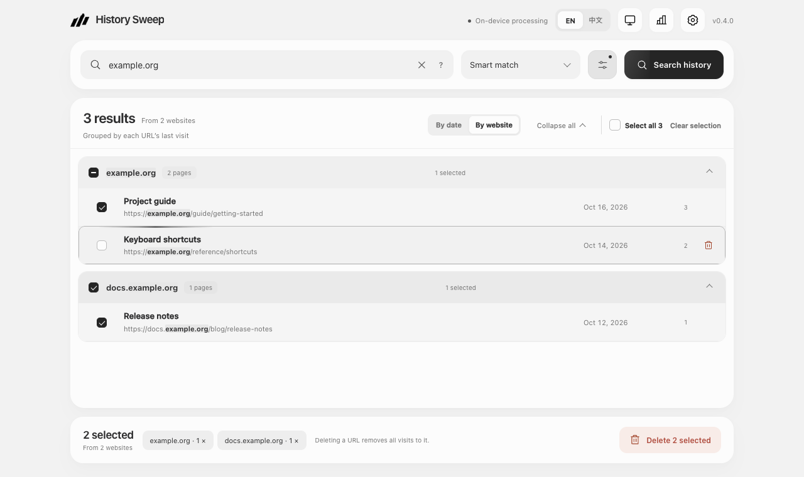
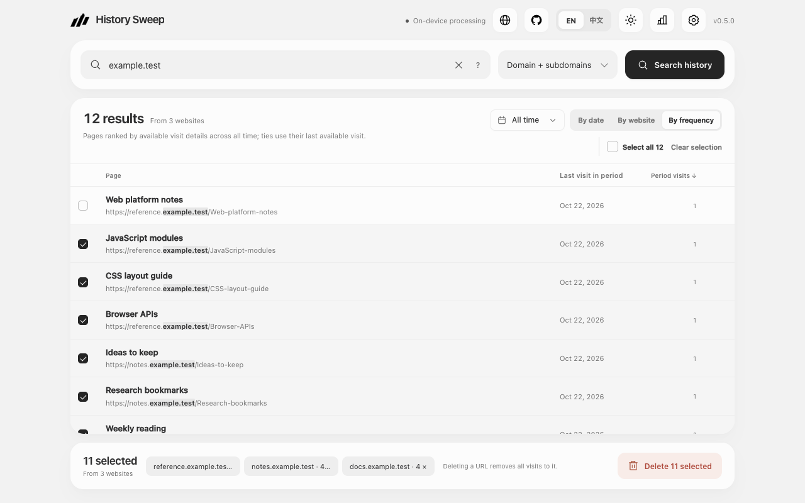
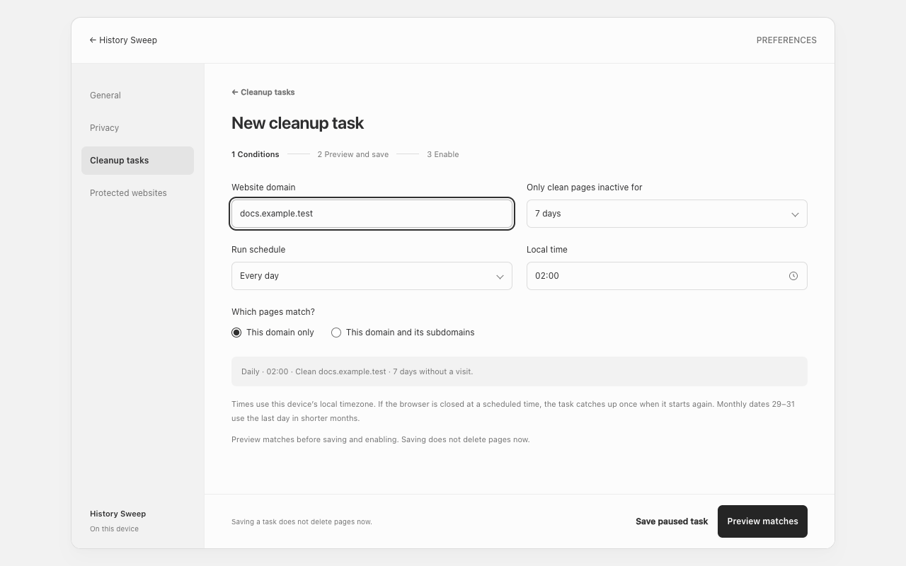

# History Sweep

**English** · [简体中文](README.zh-CN.md)

Find the browsing history you want to remove. Keep everything else.

History Sweep is a Chrome extension that helps you search, review, and delete browsing history by website, keyword, or date. Clear a single page or a batch of results without wiping your entire history. Everything is processed on your device, with no account or history upload.

[Install from Chrome Web Store](https://chromewebstore.google.com/detail/bbccfejdhhcjmpfagjckiikgllpojhgm) · [Website](https://sweep.agentclub.dev/)

## What you can do

- **Find the right pages.** Search by website, exact domain, domain and subdomains, or words in page titles and URLs. Suggestions from your own history help you complete a search, with support for Simplified and Traditional Chinese text.
- **Narrow down by date.** Choose No limit, today, the last 3, 7 or 30 days, or a custom date range. You can also search by date without a keyword.
- **Browse recent history by date or website.** Opening the extension shows the last three local calendar days. Expand a date to see website summaries, or switch to website grouping over the same results. Counts refer to unique pages, grouped by each URL’s last visit.
- **View local activity.** The chart icon beside Settings opens a yearly or three-month heatmap. Cleanup totals include verified tasks and confirmed removed URLs, starting when tracking begins. Daily counts and one website summary per date stay on this device: hostname, latest page title when available, and last-visit time. Full deleted URLs are not logged. Both views show website icons ordered by latest visit, wrapping onto additional rows; hover to preview a date and click to pin it. The browsing view groups existing pages by their last visit date, not daily visit counts.
- **Keep websites you care about.** Add domains to your kept websites. Their pages and subdomains stay out of deletion.
- **Delete one page or a batch.** Review the selected URLs before confirming. Deleting a single row leaves your other batch selections in place.
- **Choose your space.** Use a compact toolbar popup, a full-page workspace, or a modal over the current webpage. Change the opening method in Preferences.
- **Search the current website.** Use the popup's current-website button or the page's right-click menu to find that site's history.
- **Use English or Simplified Chinese.** Switch languages in the extension; your choice is remembered.

The overview above illustrates v0.4.0. The Chrome Web Store release was verified as **v0.6.0** on November 1, 2026; local release materials now target the **v0.7.0 candidate**. This does not confirm store availability. Its additions and the earlier v0.6.0 package are described below.

## Release candidate — v0.7.0

Prepared locally for review; not submitted or published. Includes recommended cleanup, saved searches, AND filters, exact-URL protection, visit details and deletion impact, manual website labels, cleaned-link copying, selected-result export, activity clearing, interruption notices, selective encrypted recovery, progressive results and settings tabs. WebDAV transfer and manifest permissions are unchanged. Restored tasks stay paused; deletion still removes all visits to each URL.

See [release materials and verification](store/v0.7.0-candidate.md), [workspace tools](docs/workspace-tools.md) and the [shared bilingual release notes](site/releases.html). The public update hint is kept separate from the candidate version.

## Previous release — v0.5.0

v0.5.0 includes [frequency browsing and defaults #8](https://github.com/agent-club/history-sweep/issues/8), navigation and privacy improvements, and [configuration sync #14](https://github.com/agent-club/history-sweep/issues/14). Public availability is verified from the [Chrome Web Store listing](https://chromewebstore.google.com/detail/bbccfejdhhcjmpfagjckiikgllpojhgm). GitHub planning status is managed separately.

- **Browse by frequency.** Choose **By frequency** to rank pages by visits within the selected period. Ties use the last visit within that period. A page remains eligible if it was also visited later. Date and website views continue to filter by each URL’s last visit. Incomplete counts are reported as an error rather than shown as a partial ranking.
- **Set your browsing defaults.** First use opens **By website** for today and the previous six local calendar days. Save the default view and relative range in **Preferences → Default browsing settings**. Temporary filters leave those defaults unchanged; fixed custom dates cannot be saved as defaults. Keyword searches still use all time unless you explicitly choose a range.
- **Private cleanup.** Save **Preferences → Private cleanup** to stop new cleanups from saving counts or website details in Local activity. Existing activity stays on this device. The activity panel opens with Browsing history first; scrolling up can collapse it, and group headings stay visible as you browse.
- **Return and reopen quickly.** A lower-right **Back to top** button returns to the beginning of a long list and respects reduced motion. With no saved opening preference, the extension opens over the current webpage; existing opening choices are preserved. **Preferences → Change keyboard shortcut** shows Chrome’s current binding and opens its shortcut settings; Chrome must be focused.
- **Sync configuration and keep a recovery file.** Use **Preferences → Sync & disk backup** to manually transfer language, appearance and opening preferences to your own HTTPS WebDAV file. Export a password-encrypted disk backup outside the extension folder for recovery after uninstall. Host access is requested only when you initiate a connection test or transfer; browsing history is excluded. The provider can read the remote JSON.

These screenshots were captured from the original v0.5.0 ZIP in an isolated browser with synthetic native history. v0.5.0 is publicly available on the Chrome Web Store; the listing shows an October 23, 2026 update date, not an exact publication timestamp. [Store copy and package evidence](store/v0.5.0-candidate.md) retain the submission history. WebDAV sync and encrypted disk backup are included. Website classification, history tags and tracking-parameter cleanup are not included.

## Quick start and release notes

v0.6.0 includes an optional three-step guide under **Preferences → Quick start** and the **?** beside search. Its first-use hint can be dismissed; opening help keeps the current search, selection and unsaved preferences. **Preferences → Version & updates** includes offline release notes. The bilingual [website release notes](site/releases.html) use the same source, with published packages, candidates and later development changes marked separately. These help features are not in the published v0.5.0 package.

Edit `extension/release-notes.mjs`, then run `npm run notes:generate` to refresh the website page; the build also generates it. Verify help with `npm run test:help`. The package and website both preset v0.6.0 as Published, and update metadata targets 0.6.0. These local materials do not establish that store submission or website deployment has occurred.

## Earlier package — v0.6.0

The v0.6.0 package includes the changes below. Its October 26 local preparation did not include submission or deployment; the public store was verified at v0.6.0 on November 1. See [release materials and verification](store/v0.6.0-candidate.md). Existing v0.5.0 screenshots above retain their original scope.

**Version & updates.** v0.6.0 adds a permanent entry in Preferences with your installed version, install source, last check and manual retry. Published releases, Chrome-ready downloads, deferred checks and failures have separate states. A published release can prompt before Chrome makes it ready; only a Chrome-confirmed download enables reload. Deletion, verification and unsaved settings block reload. Unpacked installs show manual replacement instructions without contacting the version service. Official store installs check public version metadata automatically at most once per 15 minutes; a manual retry can refresh metadata while respecting the Chrome API cooldown. No browsing history, search terms or configuration is sent; the website host receives standard connection metadata. This redesign is included in the v0.6.0 release package.

**WebDAV in settings.** Open **Preferences → Sync & disk backup** to configure WebDAV, sync manually or manage disk backups inside the same settings window as cleanup tasks. Switching settings sections preserves connection drafts. Included in the v0.6.0 release package.

**Your nameplate.** Use the card icon in the top bar or **Preferences → General → My nameplate** to see a locally assigned keepsake in one of four finishes: matte obsidian, ivory, aurora or champagne gold. New installs receive one at installation. Their first opening moves directly from loading into an orbital card reveal; collecting or closing it reveals the workspace. This automatic reveal runs once, while the card icon replays it on demand. Each finish has its own light and backdrop. Existing installs receive a card on first opening without automatic onboarding. The finish, decorative number and first-received date stay on this device and are retained across openings and updates. Drag or use arrow keys to rotate, click to flip, or pause the default slow rotation. Hover adds a subtle tilt and highlight, with drifting glints and halos around the card. Reduced motion skips the entrance, starts with rotation paused and removes ambient animation. The version chip beside the brand opens version and update details. Nameplates are excluded from configuration sync and disk backups; uninstalling clears them. Included in the v0.6.0 release package.

**Copy a URL.** Hover a history row or focus it with the keyboard to reveal a copy button beside its URL, together with the delete button. Copy keeps the full address, including query parameters and fragments, without changing the selection. A brief confirmation appears after copying; if copying is blocked, a dialog offers the full URL for manual copying. Touch devices keep the controls visible. Included in the v0.6.0 release package.

**Cleanup tasks.** Open **Preferences → Cleanup tasks**. In the in-page modal, settings use the same container and returning preserves the search and list state. You can also create a task from a website group or an explicit website search. Choose a one-time date or a daily, weekly, or monthly schedule in local time, optionally combined with 1, 7, 30, or a custom number of full days without a visit. Tasks match an exact domain or include its subdomains. Preview before enabling; saving does not delete pages. One-time tasks finish after their scheduled attempt. Monthly dates that do not exist use the month's last day; an overdue restart catches up once before scheduling the next occurrence. Existing rules retain their 24-hour interval until edited. Protected websites take priority; overlapping scopes are rejected. Pause individual tasks or all cleanup. “Preview cleanup” shows the matching scope before a separate deletion confirmation and leaves scheduled occurrences unchanged. Each run rescans and verifies deletions; verified activity distinguishes automatic and manual cleanup. Private cleanup stores no new completion history, and soft privacy hides results. Tasks stay on this device and are excluded from configuration sync and disk backups. Deleting a URL removes all its visits. Browser shutdown or sleep can delay execution. Included in the v0.6.0 release package.

**v0.7.0 candidate update:** Hover over a task to reveal **Run now** and **Edit** in a compact action group. Keyboard focus also reveals the group; touch devices keep it visible. The schedule switch stays visible. Review that task’s matching pages and confirm deletion before it runs. Other tasks and scheduled times stay unchanged. Paused or finished tasks cannot run immediately.

**Local activity disclosure.** Click **Expand analysis** in the compact entry above search to open local activity in place, then click **Collapse analysis** to close it. Scrolling the history list keeps the current open or closed state. Query, grouping and the list position are retained. The entry supports keyboard activation, Escape closes the panel, and reduced motion skips the disclosure animation. Included in the v0.6.0 release package.

**View order and visibility.** In **Preferences → View order and visibility**, choose which of the date, website and frequency views appear and drag their handles or use the arrows to reorder them. Keep at least one view visible; hiding the default selects the first remaining view, while choosing a default also shows it. Saved changes apply when reopening History Sweep. This local preference is excluded from sync and disk backups and is included in the v0.6.0 release package.

**Unsaved preferences.** Closing Preferences after changing a setting asks whether to keep editing, discard the changes, or save and close. Unchanged settings, including values changed back to their original state, close directly. Browser-controlled popup dismissal and tab closure cannot show this confirmation. Included in the v0.6.0 release package.

**Soft privacy.** Save **Preferences → Hide cleanup activity (soft privacy)** to hide cleanup totals, heatmap and website details while keeping the records. **Show cleanup activity / Hide cleanup activity** in the Cleanups view switches display at any time and updates other open extension views. Browsing history remains visible. Recording new cleanups still follows **Private cleanup**. This local preference is excluded from sync and disk backups. Included in the v0.6.0 release package; the v0.5.0 screenshots above retain their original scope.

## Candidate additions — v0.7.0

**Progressive results.** Website and date lists, including websites within an expanded date, and the frequency list append more results as you scroll near the end. Each website keeps its five-row preview and a button to show 20 more records at a time, or the remaining records when fewer are left. Appending preserves the scroll position and selection; selecting a whole group or all matches still includes records not yet shown. Included in the v0.7.0 candidate package. Historical website media retain their documented versions.

**Visited settings pages.** Compact tabs stay at the top of Preferences. Click a tab to return to its page without losing its draft; each tab has a close button. When tabs exceed the available width, use the **…** menu, horizontal scrolling, or a touch swipe to reach them. Closing an edited page asks before discarding changes. Closing the current tab selects its adjacent tab; closing the final tab returns to browsing history. Included in the v0.7.0 candidate package. Historical website media retain their documented versions.

**Recommended cleanup.** A quiet strip inside the results offers reasons without changing their order or selection. Preferences → Recommended cleanup lets you choose exact websites or subdomains, always suggest their records or require 1–365 days without a visit, adjust the cleanup-history lookback and distinct-date threshold, and enable extension records or app protocols. Defaults remain at least two different local cleanup dates within the past seven days, including today. Multiple reasons merge into one record; kept websites take priority. Missing last-visit times and legacy website summaries are not inferred. Soft privacy suppresses cleanup-derived recommendations. Preview uses the current search results and the unsaved draft, without selecting or deleting anything. Settings are stored on this device; daily or weekly animation limits store only a timestamp, and reduced motion skips animations. Verified residual hints remain available independently of recommendation rules. Included in the v0.7.0 candidate package; historical v0.6.0 assets remain unchanged.

## When History Sweep fits

### Workspace tools — v0.7.0 candidate

The current `extension/` source adds saved searches, explicit AND filters, exact-URL protection, per-URL visit details, manual website labels, cleaned-link copying, selected-result export, local cleanup-activity clearing, an interruption notice, and optional local sections in encrypted disk backups. Website labels support individual text/background colors, six color combinations, three built-in background textures and local images, with a live preview. Find **Saved searches** and **Advanced filters** below search; each page's **Page actions** menu contains the contextual tools. **Preferences → Privacy** clears existing Local activity. In **Sync & disk backup**, explicitly choose whether a disk file includes kept websites/URLs, browsing defaults or task scopes; imported tasks remain paused. WebDAV transfer is unchanged. These additions are included in the v0.7.0 candidate ZIP and absent from v0.6.0. They do not establish public availability. See [usage, data boundaries and verification commands](docs/workspace-tools.md).

Choose History Sweep for a deliberate cleanup: find a website, review the matching URLs, keep exceptions, and confirm what to remove.

- **A website and a mention of it are different.** Smart match for `example.org` matches that domain and its subdomains. A URL such as `https://example.com/?query=example.org` does not belong to that website. Choose **Title or URL** when you want to find the text instead.
- **Keep control of the selection.** Review results by website, select a group or individual pages, and leave the pages you want to keep. Kept-website rules provide another way to exclude domains and their subdomains.
- **Review before, check afterward.** The confirmation lists selected URLs by website. After deletion, History Sweep checks the selected URLs for remaining visits and reports the result.

Different workflows call for different tools. In our hands-on comparison, **Better History 7.0.0** offered a broader history-browsing workspace with date/hour navigation and export controls. **History Cleaner Pro by HVS 1.1** offered a compact keyword-search popup with selection and deletion confirmation. **History Cleaner by Tags 3.2.0** exposed tag/rule and automatic-cleanup settings; scheduled execution was not evaluated. History Sweep focuses on search, selection, and a reviewed cleanup.

See the [test setup, observations, and limits](docs/comparison-2026-10.md). The comparison uses the **0.3.2 repository build**, with an October 1, 2026 comparison and a limited competitor UI recheck on October 2. No competitor deletion was executed in the October 2 recheck. It is a small, single-environment task comparison, not a speed benchmark or a claim of overall superiority. The Chrome Web Store may serve a different version; check your installed version before comparing features.

The local website source now includes a [five-tool comparison](site/compare.html), with the homepage card deck, bilingual task differences, source dates and testing limits. The website and updated privacy policy were deployed on October 22, 2026; v0.5.0 public availability was verified on October 25, 2026. The October 22 source review is separate from the earlier hands-on comparison above.

## Get started

Install from the [Chrome Web Store](https://chromewebstore.google.com/detail/bbccfejdhhcjmpfagjckiikgllpojhgm), pin History Sweep to your toolbar, and click its icon. Requires Chrome 110 or later.

1. Browse the last week by website immediately, or enter a website or keyword and search. Choose a date range to narrow results; empty searches respect explicit dates.
2. Review the results and select the pages you want to remove. Website selection and Select all include matching pages beyond those currently visible.
3. Click **Delete selected**, review the confirmation, and confirm. You can cancel without removing anything.

Confirmed deletion continues if you close the extension view. Keep Chrome running, then reopen History Sweep and search again to review the result. Opening the full page carries over your search conditions; select the pages again in that view.

You can also download a package from the [website](https://sweep.agentclub.dev/#get). Unzip it, open `chrome://extensions`, enable **Developer mode**, choose **Load unpacked**, and select the extracted folder. If using this repository directly, select `extension/`.

The current repository source defaults to a modal over the current webpage when no opening preference is saved. Existing saved choices are preserved; change the opening method in Preferences.

## Your history stays on your device

Configuration sync is included in **v0.5.0** and is absent from v0.4.0. It is available under **Preferences → Sync & disk backup**. Configure a WebDAV endpoint, save the connection locally, and upload or download lightweight preferences manually. Browsing history, cleanup activity, kept websites, browsing defaults and Private cleanup preferences are excluded. Future tag and domain-label configuration fields are reserved. See [configuration sync and recovery](docs/config-sync.md).

Export a password-encrypted backup outside the extension folder to keep connection settings after uninstalling. Chrome removes extension-owned storage on uninstall; reinstall recovery requires importing that file and entering its password. Backups are manual snapshots.

History Sweep does not upload browsing history, require an account, or add analytics. Searches, suggestions, and deletion are processed locally. Your language, appearance, kept websites, and opening preference are saved on this device.

Chrome's history permission lets the extension search, remove, and verify records. The favicon permission displays Chrome-provided website icons beside website group headings. Other permissions support the current-website action, right-click entry, in-page modal, and saved preferences. The extension does not collect page content or run remote code.

Read the [privacy policy](https://sweep.agentclub.dev/privacy) for details.

## Before you delete

**Deletion cannot be undone. Removing a URL deletes all visits to it, including visits outside your chosen date range.** Date filters use each URL's last visit. Chrome may sync history deletions across signed-in devices.

Each search reads up to 100,000 URLs. If that limit is reached, a notice appears and older records may be missing. Suggestions and current-website searches never select or delete pages automatically.

Keep Chrome open until deletion finishes. Interrupted manual deletions do not resume after Chrome exits, the extension reloads, or its background process stops unexpectedly. Scheduled cleanup tasks rescan when Chrome runs again. If a webpage cannot display the in-page modal, History Sweep opens the full workspace instead.

## Feedback

Found a problem or have a suggestion? [Open an issue](https://github.com/agent-club/history-sweep/issues).

## License

Unless otherwise noted, History Sweep's project-owned source code is licensed under the Mozilla Public License 2.0 (MPL-2.0). See [LICENSE](LICENSE).

Third-party components and assets retain their respective licenses and notices.
