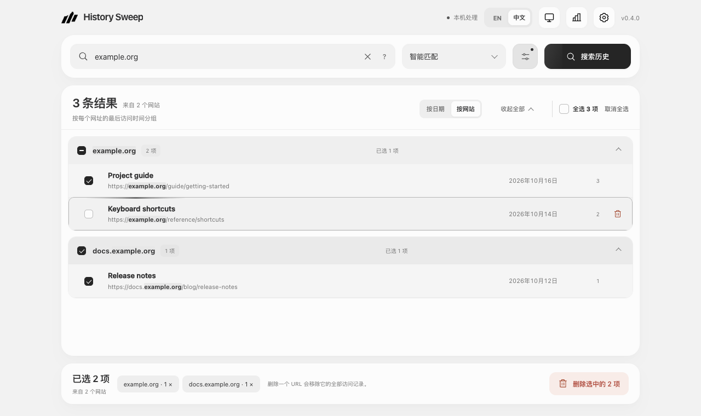
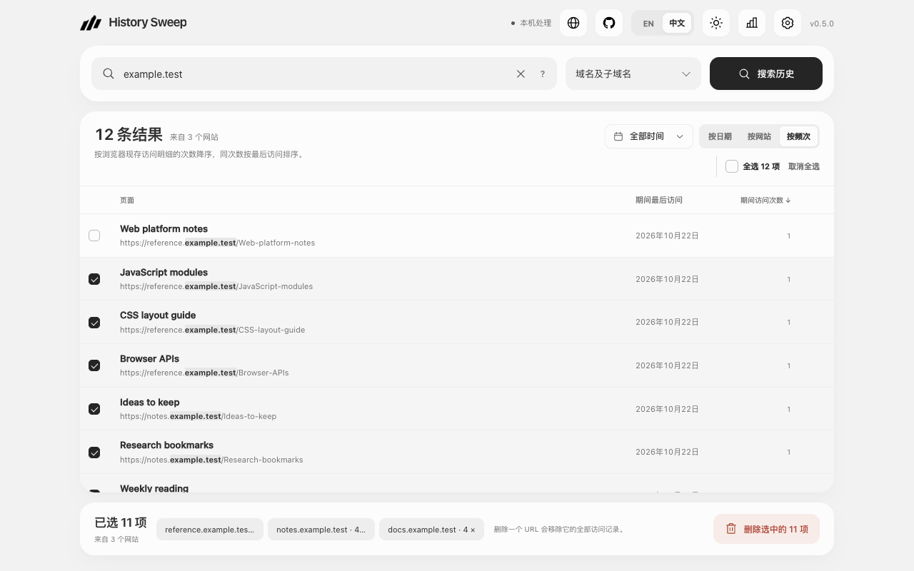

# History Sweep

[English](README.md) · **简体中文**

找到想删除的浏览记录，留下其余内容。

History Sweep 是一款 Chrome 插件，帮助你按网站、关键词或日期搜索、查看和删除浏览历史。你可以删除单个页面，也可以批量清理选中的记录，无需清空全部历史。所有处理都在本机完成，不需要账号，也不上传浏览记录。

[从 Chrome 应用商店安装](https://chromewebstore.google.com/detail/bbccfejdhhcjmpfagjckiikgllpojhgm) · [访问官网](https://sweep.agentclub.dev/)

## 可以做什么

- **找到要清理的页面。** 按网站、精确域名、域名及子域名，或页面标题和网址中的关键词搜索。本地历史记录提供输入建议，支持简繁中文匹配。
- **按日期缩小范围。** 选择今天、最近 3 天、7 天、30 天或自定义日期范围，也可以只按日期搜索。
- **按日期或网站浏览。** 打开后直接展示最近三个本地自然日的记录。展开日期查看网站汇总，也可切换为同一批结果的网站分组。计数表示不同网页，日期按每个网址的最后访问时间归属。
- **查看本地活动。** 设置旁的图表按钮展开全年或近三个月的热力图。清理统计从开始记录之日起累计，仅计已复查的任务和确认移除的 URL；只在本机保存每日次数，以及每个日期下各网站的域名、最近页面标题（若有）和最后访问时间，不保存已删完整 URL。两种视图均按最近访问时间展示网站图标，超出自动换行；悬浮日期预览，点击固定。浏览视图按现存网页的最后访问日期归属，不代表每日访问次数。
- **保留重要网站。** 将域名加入保留网站列表，该域名及其子域名下的记录不会被删除。
- **单条或批量删除。** 确认前查看待删除的网址。删除单条记录时，其余批量选择会保留。
- **选择合适的操作空间。** 使用工具栏小窗、完整页面，或覆盖在当前网页上的浮窗。在偏好设置中选择打开方式。
- **查找当前网站的历史。** 点击小窗中的当前网站按钮，或使用网页右键菜单，查找该网站的浏览记录。
- **使用英文或简体中文。** 可以在插件内切换语言，插件会记住你的选择。

以上概览展示 v0.4.0 的操作。当前 Chrome 应用商店公开版本为 **v0.5.0**，已于 2026 年 10 月 25 日核实。新版变化见下文，后续开发内容单独标注。

## 当前版本 — v0.5.0

v0.5.0 包含[频次浏览与默认设置 #8](https://github.com/agent-club/history-sweep/issues/8)、导航与隐私改进，以及[配置同步 #14](https://github.com/agent-club/history-sweep/issues/14)。公开状态以 [Chrome 应用商店页面](https://chromewebstore.google.com/detail/bbccfejdhhcjmpfagjckiikgllpojhgm)为准，GitHub 计划状态另行维护。

- **按频次浏览。** 选择**按频次**，按所选期间的访问次数降序查看页面，同次数按期间最后访问时间排序。期间访问过、之后又访问的网页仍可包含；按日期和按网站继续依据每个网址的最后访问时间筛选。无法完整统计时报告错误，不展示部分排名。
- **配置默认浏览方式。** 首次默认**按网站**浏览**近一个星期**，覆盖今天及之前六个本地自然日。在**偏好设置 → 默认浏览设置**中保存默认视图和相对时间范围。临时筛选不改变默认值，固定自定义日期不能保存为默认。关键词搜索仍默认全部时间，除非明确选择日期。
- **无痕清理。** 保存**偏好设置 → 无痕清理**后，新清理不在本地活动中保存次数或网站明细，已有记录保留在本机。本地活动优先展示“浏览记录”，向上滚动可折叠活动面板；浏览列表时分组标题保持可见。
- **快速返回与打开。** 长列表右下角的**返回顶部**按钮可回到开头，并遵循“减少动态效果”设置。没有已保存打开偏好时，默认以当前网页上的浮窗打开，已有选择保留。**偏好设置 → 修改快捷键**显示 Chrome 当前绑定并打开快捷键设置，快捷键在 Chrome 获得焦点时生效。
- **配置同步与恢复。** 在**偏好设置 → 同步与磁盘备份**中，将语言、外观和打开方式手动传输到自己的 HTTPS WebDAV 文件。可将密码加密备份导出到插件目录之外，以便卸载后恢复。只有主动测试连接或传输时才申请目标主机访问权限，不传输浏览历史；远端 JSON 可由所选服务商读取。
- **商店更新检查。** 官方商店安装版打开时检查公开版本提示，两次请求至少间隔 15 分钟；适用时再请求 Chrome 官方更新检查。只有 Chrome 确认下载完成才显示可操作的更新按钮，删除或复查期间不能重新加载。解压安装版跳过此请求。不发送浏览历史、搜索词或配置，网站托管方仍会接收标准连接信息。

截图来自原始 v0.5.0 ZIP，在隔离浏览器中使用合成的原生历史记录。v0.5.0 已在 Chrome 应用商店公开提供，商店标注更新于 2026 年 10 月 23 日，该日期不作为精确发布时间。[商店文案与安装包证据](store/v0.5.0-candidate.md)保留提交历史。本版包含 WebDAV 同步和加密磁盘备份，不包含网站分类、历史标签与链接追踪参数净化。

## 什么时候适合用 History Sweep

如果你想清理某个网站的部分历史，先核对匹配的网址、留下例外，再确认删除，History Sweep 就围绕这条流程设计。

- **网站本身，与提到它的文字，分开查找。** 智能匹配 `example.org` 会匹配该域名及其子域名。`https://example.com/?query=example.org` 只是网址参数里提到了它，并不属于该网站。想搜索这段文字时，可以选择**标题或网址**模式。
- **由你决定保留哪些页面。** 按网站查看结果，整组或逐条选择，留下想保留的页面。也可以使用保留网站规则，排除指定域名及其子域名。
- **删除前核对，删除后复查。** 确认窗口按网站列出所选网址。删除后，History Sweep 检查这些网址是否仍有访问记录，并报告结果。

不同工具适合不同任务。在实际操作中，**Better History 7.0.0** 提供了更广的历史浏览工作台，包括日期、小时导航及导出入口；**History Cleaner Pro by HVS 1.1** 将关键词搜索、选择和删除确认集中在紧凑小窗；**History Cleaner by Tags 3.2.0** 提供标签、规则和自动清理设置，本轮未验证定时执行。History Sweep 则专注于搜索、选择和经过核对的清理。

查看[测试方法、观察和边界](docs/comparison-2026-10.md#简体中文)。对比使用 **0.3.2 仓库版本**，保留 2026 年 10 月 1 日的对比记录，并于 10 月 2 日补充有限的竞品界面复查。10 月 2 日未执行竞品删除。这是单一环境、小样本的任务体验比较，不是速度测试，也不代表全面领先。Chrome 应用商店提供的版本可能不同；比较功能前，请先确认已安装的版本。

本地官网源码已加入[五款工具对比](site/compare.html)，包含首页牌组、中英文任务差异、资料日期及实测边界；官网与新版隐私说明已于 2026 年 10 月 22 日部署，2026 年 10 月 25 日已核实 v0.5.0 公开可用。10 月 22 日的资料核对与上述早期实测分别注明。

## 开始使用

从 [Chrome 应用商店](https://chromewebstore.google.com/detail/bbccfejdhhcjmpfagjckiikgllpojhgm)安装，将 History Sweep 固定到工具栏，然后点击图标。需要 Chrome 110 或更新版本。

1. 直接按网站浏览近一个星期，或输入网站、关键词后搜索。可选择日期缩小范围；空搜遵循已明确选择的日期。
2. 查看结果，选中要删除的页面。按网站选择和全选都会包含当前尚未显示的匹配页面。
3. 点击**删除所选**，检查确认内容后再确认。取消不会删除任何记录。

确认删除后，即使关闭插件界面，任务仍会继续。请保持 Chrome 运行，之后重新打开 History Sweep 并搜索，查看清理结果。打开完整页面时会带入搜索条件，但需要重新选择待删除的页面。

你也可以从[官网](https://sweep.agentclub.dev/#get)下载安装包。解压后打开 `chrome://extensions`，启用**开发者模式**，点击**加载已解压的扩展程序**，选择解压后的文件夹。如果直接使用本仓库，选择 `extension/` 目录。

当前仓库源码在尚未保存打开方式时，默认以覆盖当前网页的浮窗（Modal）打开。已有选择会保留，可在偏好设置中修改打开方式。

## 浏览记录留在本机

配置同步纳入 **v0.5.0**，v0.4.0 未提供。可在**偏好设置 → 同步与磁盘备份**中配置 WebDAV 地址，将连接保存在本机，并手动上传、下载轻量偏好。浏览历史、清理活动、保留网站、默认浏览设置和无痕清理偏好不会上传；历史打标与域名分类标签配置已预留结构。详见[配置同步与恢复说明](docs/config-sync.md)。

需要卸载后保留连接时，请导出密码加密的备份，并保存在插件目录之外。Chrome 卸载插件会清除插件存储；重装后须选择备份文件、输入密码才能恢复。备份为手动快照，配置修改后需重新导出。

History Sweep 不上传浏览历史，不需要账号，也不添加分析追踪。搜索、输入建议和删除都在本机处理。语言、主题、保留网站和打开方式偏好仅保存在当前设备。

Chrome 的历史记录权限用于搜索、删除及核验记录。favicon 权限用于在网站分组标题旁显示 Chrome 提供的网站图标。其余权限用于当前网站入口、右键菜单、页面内浮窗和保存偏好。插件不收集网页内容，也不运行远程代码。

详情请查看[隐私政策](https://sweep.agentclub.dev/privacy)。

## 删除前须知

**删除后无法恢复。删除一个网址会移除它的全部访问记录，包括所选日期范围之外的访问。** 日期筛选依据每个网址的最后访问时间。Chrome 可能会将删除同步到已登录的其他设备。

每次搜索最多读取 100,000 个网址。达到上限时会显示提示，更早的记录可能未包含。输入建议和当前网站搜索不会自动选中或删除记录。

请保持 Chrome 运行直到删除完成。浏览器退出、插件重新加载或后台进程意外停止后，任务不会恢复。如果当前网页无法显示页面内浮窗，History Sweep 会打开完整页面。

## 反馈

发现问题或有建议？欢迎[提交 Issue](https://github.com/agent-club/history-sweep/issues)。

## 许可证

除另有说明外，History Sweep 自行编写的源代码采用 Mozilla Public License 2.0（MPL-2.0）许可证，详见 [LICENSE](LICENSE)。

第三方组件与素材保留各自的许可证和声明。
