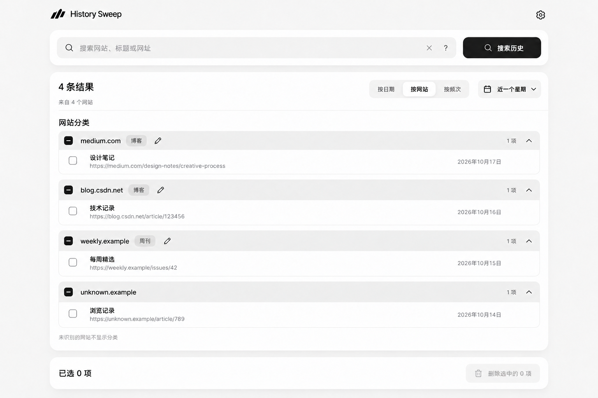
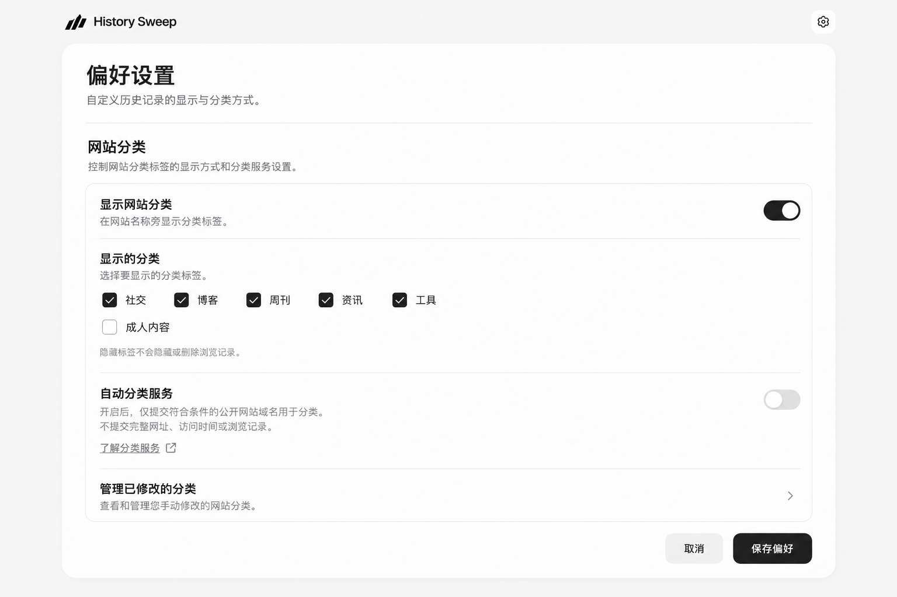

# 网站分类概念稿

使用内置 ImageGen 生成三个场景，沿用 History Sweep 公开演示界面的黑白圆角风格。全部浏览记录为虚构示例；图片用于对稿，功能尚未实现。生成原文及展示稿的数据修正提示词保存在 [prompts.json](prompts.json)。

| 分类展示 | 分类编辑 | 展示控制 |
| --- | --- | --- |
|  |  |  |
| Medium、CSDN 显示博客，虚构周刊站显示周刊，未识别网站不显示标签。 | 修改本机展示标签、隐藏该网站分类、恢复自动；自动更新不覆盖手动修改。 | 分开控制标签总展示、具体类别可见性和在线分类服务。隐藏标签不隐藏或删除记录。 |

对稿需确定：固定类别与多标签范围、“成人内容”的最终文案与默认可见性、服务启用方式，以及精确域名的编辑范围。图中资讯、工具和各开关默认值为方案建议；没有改变现有产品配置。编辑稿的虚构背景日期不用于验证时间范围，焦点为分类编辑弹窗。

分类服务需先验证 TDK 抓取、公开数据口径、误分率、覆盖、成本与域名传输告知。备案信息不直接作为色情分类依据，用户标签与自动结果分开保存。

详细调研、方案、排期与验收见[网站自动分类规划](../../../docs/website-classification-plan-2026-10-19.md)。
