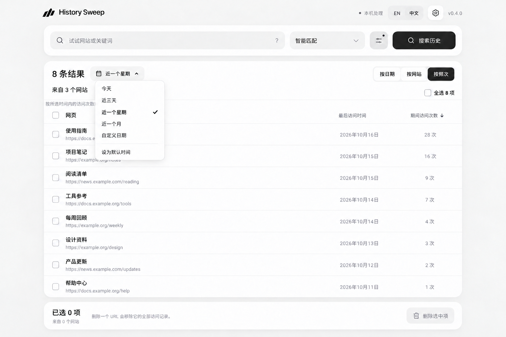
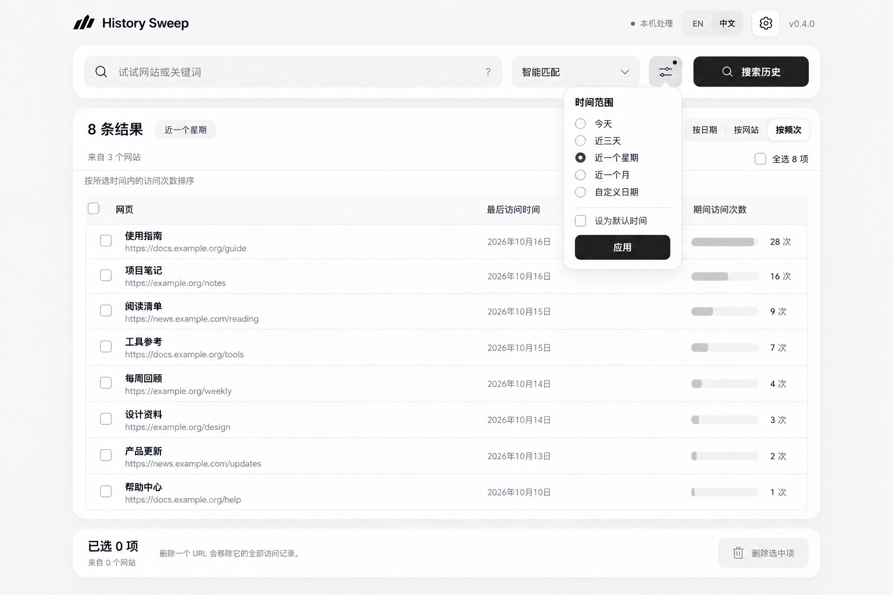
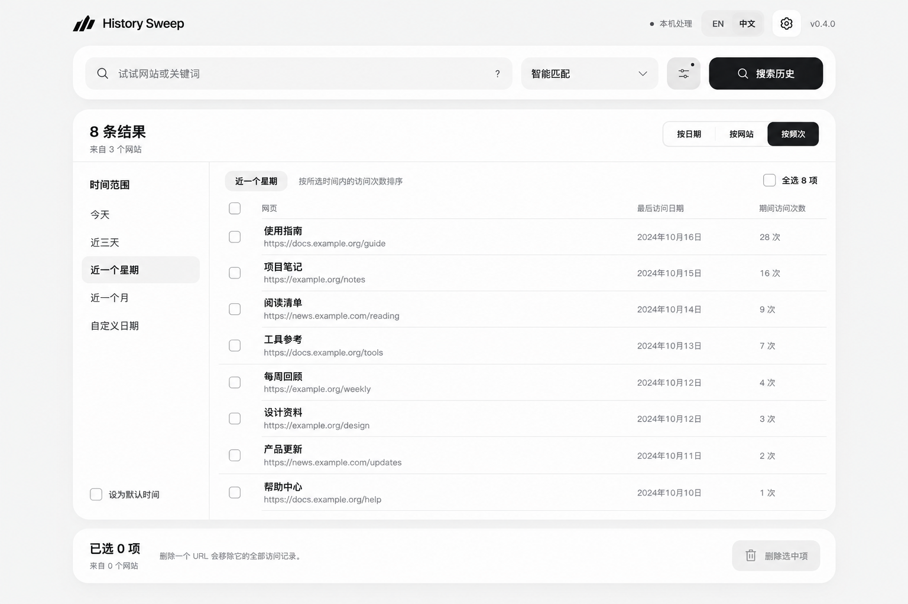
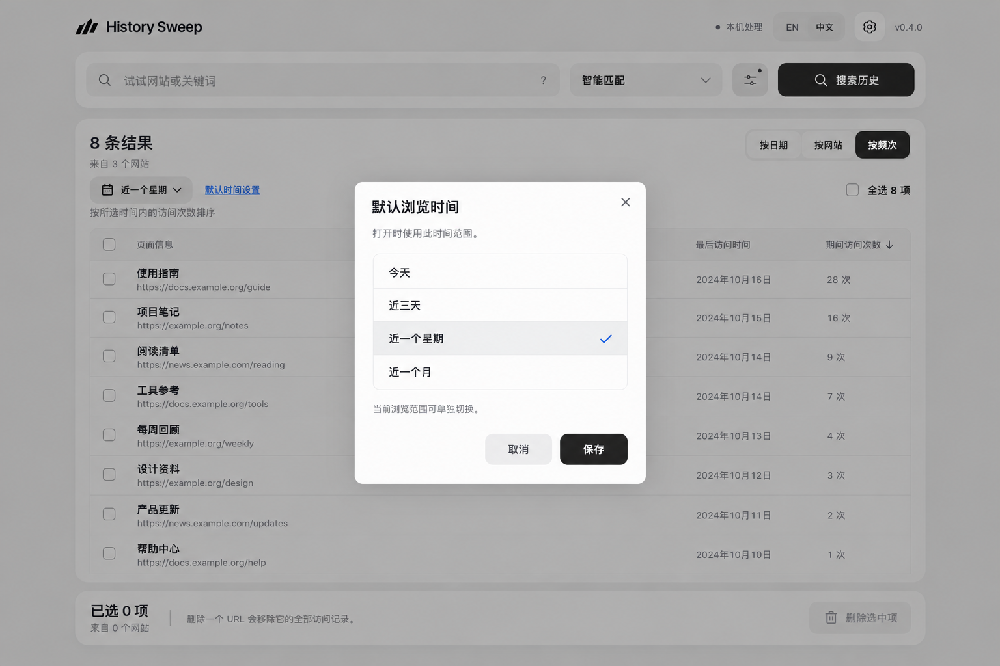

# 频次视图与时间配置：四版对稿

本轮使用内置 ImageGen 生成概念稿，沿用现有公开演示截图的视觉风格，全部浏览记录和访问次数为虚构示例。原始提示词及后续修正见 [prompts.json](prompts.json)。这些图片用于选布局和交互方向，不代表功能已经实现，示例日期不构成运行验收。

推荐优先对比 A 与 D：A 将当前时间范围放在结果旁，切换直接；D 把默认时间独立保存，行为更明确。也可以以 A 为主体，使用 D 的默认设置方式。

| A：顶部时间下拉 | B：筛选浮层 |
| --- | --- |
|  |  |
| 当前范围直接可见，最接近既有布局。需定稿下拉内“设为默认时间”的确认反馈。 | 沿用筛选入口，节省工具栏空间。需定稿应用按钮对当前范围和默认范围的作用。 |

| C：左侧时间栏 | D：默认时间设置弹窗 |
| --- | --- |
|  |  |
| 频繁切换更方便，占用列表宽度；窄窗口需另做收纳。 | 清楚区分本次查看与下次默认，多一步操作。 |

## 对稿顺序

1. 确认“按频次”是否按网页在所选期间的访问次数排列。
2. 选择时间配置入口，并确认临时切换与保存默认值的关系。
3. 确认默认“近一个星期”的自然日口径，以及关键词搜索是否继续沿用现有默认范围。
4. 选稿后实现，核对真实期间计数、三入口切换、加载与空状态，并覆盖弹窗及嵌入式窗口。

排期与验收项见 [下周迭代计划](../../../docs/iteration-plan-2026-10-19.md)。
